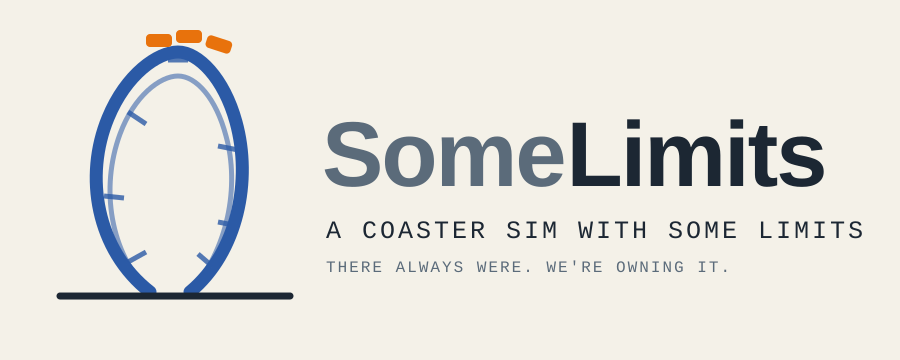

# SomeLimits

**A browser roller coaster builder with some limits.**

Place points, drag them around, set height and banking, close the loop, and ride the whole thing. No accounts, no build step, no install - one HTML file.

**[Play it in your browser](play/)** - or open `play/index.html` locally.



## Why this exists

NoLimits 1 (2001) was a relaxed, easy coaster builder: you laid track, and it worked. NoLimits 2 is far more powerful, and its editor is also where a lot of casual builders quietly bounce off - separate roll points, strict nodes, separators to learn before the first hill exists.

SomeLimits is the door back in. It is not a remake, not a clone, and not affiliated with NoLimits or Gravimetric. Original code, original assets, a similar relaxed building feel. NL2's power is respected here; the claim is only that its on-ramp locked some builders out.

The name is a dry joke: there always were some limits. We are owning them.

**The acceptance test:** a returning NL1 builder lays a full closed-circuit coaster within minutes, with zero tutorial and zero mode taxonomy.

## What you get

- A complete closed-circuit coaster, end to end: station, lift hill, drops, banked turns, inversions if you build them, brake run back to the station.
- Building is just placing points and dragging things:
  - Banking lives on the point itself (a slider, or shift-drag), with a local blend. No roll-node objects.
  - Any climb of 8 m or more between points gets a chain lift automatically, so a first build cannot stall for want of a menu.
  - Auto-smooth on drag release does the old community smoothing ritual for you, gently and locally.
- Ride mode with POV, chase, and orbit cameras, a live G-force HUD, and an honest lap summary.
- Presets that are rideable as loaded, including a vertical loop you can pull apart to see how it is built.
- A library in your browser (localStorage), plus JSON export/import, share links that encode the coaster in the URL, a NoLimits 2-style CSV spline bridge both ways, and PNG screenshots.

## Quick start

No build step. Serve the folder with any static host:

```bash
python3 -m http.server 8000
# then open http://localhost:8000/play/
```

Or just open `play/index.html` in a modern browser.

You need internet once, for the Three.js library from the CDN (`three@0.160.0` via unpkg). After that the page is just a file doing maths. Your saves never leave your browser.

## Controls, briefly

| Action | How |
|---|---|
| Move a point | Drag it on the ground |
| Bank a point | Banking slider, or shift-drag it sideways |
| Add a point | Double-click the track, or click empty ground while building |
| Ride | RIDE IT button, or `R` |
| Cameras while riding | `C` cycles POV / chase / orbit |
| Field Manual | `H` |
| Library | `L` |

Full guide: [wiki/player-guide.md](wiki/player-guide.md).

## Project layout

```
index.html       site root - sends you to the game
play/            the game: play/index.html is the whole app, one file
prototype/       the v0 prototype the app grew from - reference, frozen
wiki/            player guide, code notes, dev guide, hosting notes
research/        NL1 vs NL2 research summary
logo/            the hand-drawn SVG logo and exports
LICENSE          MIT
```

## Docs

Start at [wiki/README.md](wiki/README.md):

- [Player guide](wiki/player-guide.md) - first coaster, controls, riding, library, sharing, FAQ
- [Code](wiki/code.md) - how the single file works: track maths, physics, save formats
- [Dev](wiki/dev.md) - running locally, conventions, testing, contributing
- [Admin](wiki/admin.md) - hosting, updates, trademark posture, imagery policy

## Design rules

1. The mental model stays "place points, track appears, drag things." No separate roll-node objects, no strict-node bookkeeping, no separator system to learn before the first hill exists.
2. Banking lives on the point itself, with local blend.
3. Defaults always produce a complete rideable circuit. If a first build can stall, confuse, or dead-end, that is a bug in the design, not a skill issue for the player.
4. Advanced power reveals itself progressively and never gates the basics.
5. Honest copy. If a feature is not in, the docs say planned, not present.

## One hard rule: no AI-generated imagery

No AI-generated imagery anywhere in SomeLimits - not the logo, not textures, not splash art. All visuals are hand-drawn vector (SVG), code-rendered geometry, or clean type. Contributions follow the same rule. See [wiki/admin.md](wiki/admin.md) for the policy version.

## Status

v1, shipped and playable. The research behind the design is in [research/SUMMARY.md](research/SUMMARY.md).

## License

MIT - see [LICENSE](LICENSE). The SomeLimits name and logo are project marks; if you fork, please rename your fork.

SomeLimits is not affiliated with NoLimits or Gravimetric.
