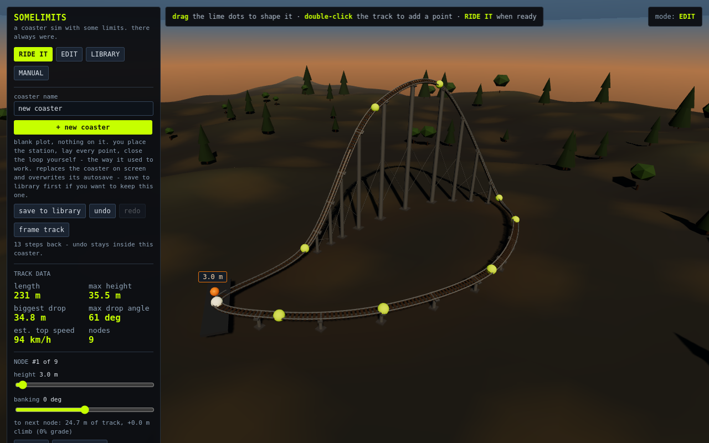
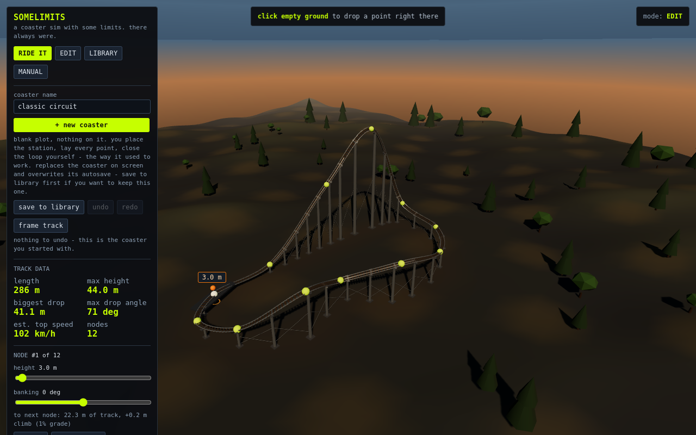

# SomeLimits

**A browser roller coaster builder with some limits.**

Place points, drag them around, set height and banking, close the loop, and ride the whole thing. No accounts, no build step, no install - one HTML file.

**[Play it in your browser](play/)** - or open `play/index.html` locally.




*Built from a blank plot the way the game teaches it: nine ground clicks and two drags of the orange height cap. Nothing else.*



## Why this exists

NoLimits 1 (2001) was a relaxed, easy coaster builder: you laid track, and it worked. NoLimits 2 is far more powerful, and its editor is also where a lot of casual builders quietly bounce off - separate roll points, strict nodes, separators to learn before the first hill exists.

SomeLimits is the door back in. It is not a remake, not a clone, and not affiliated with NoLimits or Gravimetric. Original code, original assets, a similar relaxed building feel. NL2's power is respected here; the claim is only that its on-ramp locked some builders out.

The name is a dry joke: there always were some limits. We are owning them.

**The acceptance test:** a returning NL1 builder lays a full closed-circuit coaster within minutes, with zero tutorial and zero mode taxonomy.

## Classic blueprint / elevation editor (Round 25)

**TOP** for laying out turns, **SIDE** and **FRONT** for shaping climbs and drops, **3D** for inspecting the whole coaster. The views use genuine orthographic drawing cameras, not awkward perspective shortcuts. Blank coasters start in TOP; 1/2/3/4 switch views, G focuses a node, and Frame Track fits the whole layout. In TOP, clicking to add a new point on an open track retains the current height—so the next bend after a lift crest is **not** a sudden accidental drop. The open-track **+ LEVEL / LEFT / RIGHT / DROP** buttons make each choice explicit; side/front nodes drag in fixed elevation planes. Ride mode still uses the original perspective physics camera. See [complete editor design and limitations](wiki/blueprint-elevation-editor.md).

In the latest drafting polish, **TOP gets persistent graph paper** even on closed coasters, SIDE/FRONT get real vertical elevation grids, and scenery fades out of the way only while you're drawing. The hints now follow the view, and new mobile browser tests drag and undo actual elevated points in both elevation views. [Round 26 implementation and limitations](wiki/drafting-views-round26.md).

Precision editing now includes previous/next node selection for stacked points, exact X/Z numeric controls, and view-correct arrow-key nudges (1m, Shift 5m, Option/Alt 0.1m). These commit ordinary undoable edits; selecting another node never mutates the coaster. See [Round 27 precision editor](wiki/precision-node-authoring-round27.md).

Round 28 makes elevation views proper builders: **tap SIDE to place the next X/height point, or FRONT for Z/height**, with the hidden axis inherited from the previous endpoint. A lime ghost segment previews the tap before placing; each view keeps its own zoom/pan when switching, with explicit − / FIT / + controls. No changes to coaster physics, saves, or existing gestures. See [Round 28 engineering rationale](wiki/elevation-drawing-round28.md).

Drafting now offers optional **snap off / 1m / 5m** for placing and dragging nodes in 2D; TOP previews the next segment and shows its length/height change before you click. Snapping is off by default, does not affect 3D physics or existing nodes, and lives outside your coaster's save format. [Round 29 design](wiki/drafting-snap-round29.md).

Round 30 shows a **cyan curved preview of the real next rail section** alongside the lime alignment chord, with curved length and height delta visible while drawing. Selecting an interior point and pressing **+ node** now inserts directly on the existing Catmull–Rom rail instead of a straight midpoint, while keeping chain lift continuity through the split. No changes to ride physics, existing track files or saved preset fingerprints. [Curve-truth and refinement design](wiki/curve-truth-round30.md).

## What you get

- A complete closed-circuit coaster, end to end: station, lift hill, drops, banked turns, inversions if you build them, brake run back to the station.
- Building is just placing points and dragging things:
  - Banking lives on the point itself (drag the blue grip around it, shift-drag, or a slider), with a local blend. No roll-node objects. On mobile, the grip adapts to zoom so it remains visually grab-able from a full-coaster view.
  - Any climb of 8 m or more between points gets a chain lift automatically - drawn on the track as a bright strip - so a first build cannot stall for want of a menu. There is no lift button to find.
  - Height is by hand: drag a lime point up/down, drag the orange cap above it for precision, or use the height slider. Points land at ground level, so a drop is simply what happens after a hill.
  - Each dragged point stays where you leave it. Neighbouring control points and banking are never silently rewritten on release; the spline handles smooth track transitions between your points.
- Ride mode with POV, chase, and orbit cameras, a live G-force HUD, and a lap summary that explains when the simulator had to assist a slow section. Station tires dispatch the train and keep truly flat circuits moving; chain lifts run at 7 m/s.
- Presets that are rideable as loaded, including a vertical loop you can pull apart to see how it is built.
- A library in your browser (localStorage), plus JSON export/import even for unfinished drafts, share links that encode complete coasters in the URL, a NoLimits 2-style CSV spline bridge both ways, and PNG screenshots. Blueprints are drawn only when their cards come into view, not stored as base64 ballast.

## Quick start

No build step. Serve the folder with any static host:

```bash
python3 -m http.server 8000
# then open http://localhost:8000/play/
```

Or just open `play/index.html` in a modern browser.

You need internet once, for the Three.js library from the CDN (`three@0.160.0` via unpkg). After that the page is just a file doing maths. Your saves never leave your browser.

## Controls, briefly

| Action | How |
|---|---|
| Move a point | Drag its lime dot sideways across the screen |
| Raise a point | Drag its lime dot up/down, use the orange cap, or the height slider |
| Bank a point | Drag the blue grip around it, shift-drag it sideways, or use the banking slider |
| Add a point | Double-click the track, or click empty ground while building |
| Ride | RIDE IT button, or `R` |
| Cameras while riding | `C` cycles POV / chase / orbit |
| Field Manual | `H` |
| Library | `L` |

Full guide: [wiki/player-guide.md](wiki/player-guide.md).

## Project layout

```
index.html       site root - sends you to the game
play/            the game: play/index.html is the whole app, one file
prototype/       the v0 prototype the app grew from - reference, frozen
wiki/            player guide, code notes, dev guide, hosting notes
research/        NL1 vs NL2 research summary
logo/            the hand-drawn SVG logo and exports
LICENSE          MIT
```

## Docs

Start at [wiki/README.md](wiki/README.md):

- [Player guide](wiki/player-guide.md) - first coaster, controls, riding, library, sharing, FAQ
- [Code](wiki/code.md) - how the single file works: track maths, physics, save formats
- [Dev](wiki/dev.md) - running locally, conventions, testing, contributing
- [Admin](wiki/admin.md) - hosting, updates, trademark posture, imagery policy
- [November 2026 playtest repair](playtest-2026-11-18.md) - lift/drag diagnosis and deliberate fingerprints for all four presets, 47.5m hill and flat loop
- [Main/branch and physics audit](wiki/branch-hygiene-physics-audit.md) - reconcile squash-merged PRs, cleanup plan and every preset's exact reference values
- [Editor performance + save lifecycle](wiki/editor-runtime.md) - GPU cleanup, coalesced dragging, terrain release and compact library persistence
- [Large-coaster terrain performance](wiki/terrain-proximity-bvh.md) - exact indexed nearest-segment search, 97% fewer terrain point-to-segment projections on an 80-node loop, real browser import/edit test
- [Shared node-handle materials](wiki/node-handle-material-pooling.md) - 80 independently pickable control points use two visual materials, not 80 material allocations every rebuild
- [Exact arc-parameter cache](wiki/arc-parameter-cache.md) - closed/open track sampling reuses true Three.js arc mapping for height, bank and lift, eliminating 901 redundant lookups without changing geometry
- [Support clearance performance](wiki/support-clearance.md) - indexed support checks with brute-force equivalence proof
- [Mobile and library rendering](wiki/mobile-performance.md) - phone pixel ratio cap and lazy, bounded blueprint previews
- [Browser smoke tests](wiki/browser-smoke.md) - verified full WebGL startup, desktop edit/save, simulated mobile station placement, and the mobile hint-overflow fix
- [Exact point drags](wiki/direct-point-drag.md) - remove hidden neighbour shifts and banking edits after releasing a dragged point
- [Complete-coaster lime drag](wiki/completed-lime-node-touch.md) - true mobile Chromium five-node tests of both sideways and upward non-station control-point movement, exact undo/redo and unchanged neighbors
- [Draft backup and autosave safety](wiki/draft-rescue.md) - localStorage quota warnings and rescue JSON for unfinished builds
- [Framing a lone station](wiki/station-framing.md) - why Frame Track must focus the only control point in an open draft
- [Honest lap feedback](wiki/ride-insight.md) - report when the simplified physics used a minimum-speed assist and reset G traces between rides
- [Empty draft controls and stations](wiki/empty-node-station.md) - clear non-existent node controls; always retain one station on a finished coaster
- [Touch gestures and interruption recovery](wiki/interruptions-and-touch-regression.md) - roll back unfinished drags after capture loss or browser focus loss; real Chromium touch drag/undo integration
- [First-station precision handles](wiki/first-station-precision-handles.md) - orange cap and blue bank grip are available immediately on the first station; real touch tests
- [Readable mobile banking grip](wiki/touch-grip-pixel-target.md) - why zoomed-out bank handles need touch-sized visual spacing, five-point browser proof and source-backed radius bounds
- [Bank grip follows camera zoom](wiki/mobile-bank-grip-camera-zoom.md) - keep the existing blue ring/bar/ball and touch proxy aligned while zooming, without rebuilding the coaster
- [All mobile touch halos follow zoom](wiki/mobile-touch-halo-camera.md) - lime node, orange height cap and blue grip retain their original thumb-sized reach as the camera moves
- [Extreme-bank touch ownership](wiki/extreme-bank-touch-arbitration.md) - actual mobile taps prove orange cap, blue grip and lime node stay separately selectable at -90/-80/+90 degrees

## Quality checks

The game itself remains a single HTML file and needs no build step. Maintainer-only tests run in GitHub Actions on PRs and pushes to main: editor resource/storage regression (zero dependencies) and the explicit time and top-speed fingerprints for every preset and the user playtest circuit (pinned Three.js in CI). Run `node tests/editor-runtime-regression.mjs` and `node tests/direct-point-drag-regression.mjs` for fast local audits. See [Dev](wiki/dev.md).

## Design rules

1. The mental model stays "place points, track appears, drag things." No separate roll-node objects, no strict-node bookkeeping, no separator system to learn before the first hill exists.
2. Banking lives on the point itself, with local blend.
3. Defaults always produce a complete rideable circuit. If a first build can stall, confuse, or dead-end, that is a bug in the design, not a skill issue for the player.
4. Advanced power reveals itself progressively and never gates the basics.
5. Honest copy. If a feature is not in, the docs say planned, not present.

## One hard rule: no AI-generated imagery

No AI-generated imagery anywhere in SomeLimits - not the logo, not textures, not splash art. All visuals are hand-drawn vector (SVG), code-rendered geometry, or clean type. Contributions follow the same rule. See [wiki/admin.md](wiki/admin.md) for the policy version.

## Status

v1, shipped and playable. The research behind the design is in [research/SUMMARY.md](research/SUMMARY.md).

## License

MIT - see [LICENSE](LICENSE). The SomeLimits name and logo are project marks; if you fork, please rename your fork.

SomeLimits is not affiliated with NoLimits or Gravimetric.
